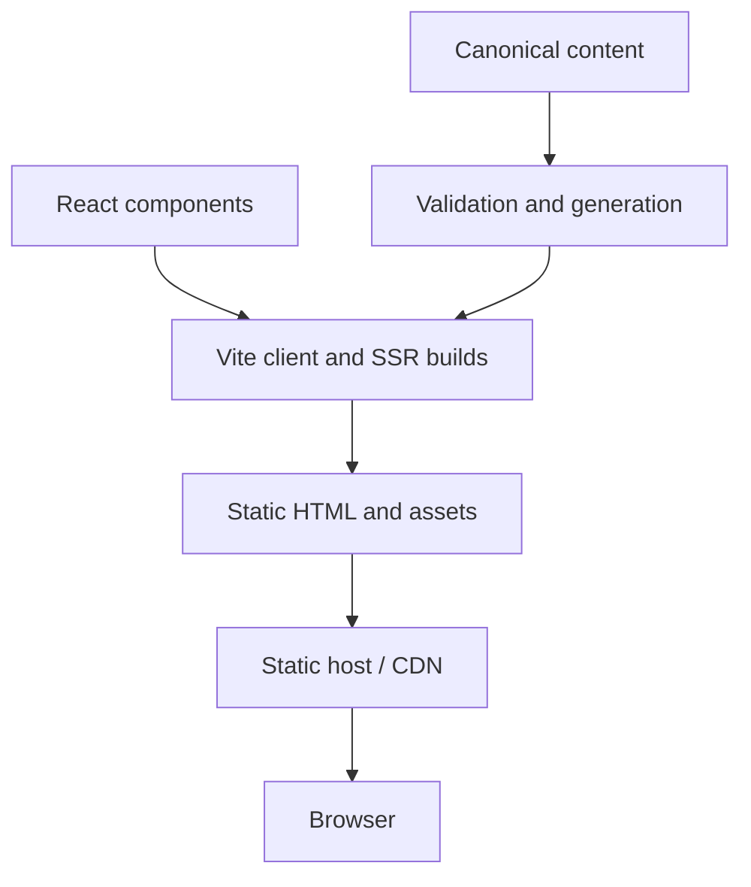
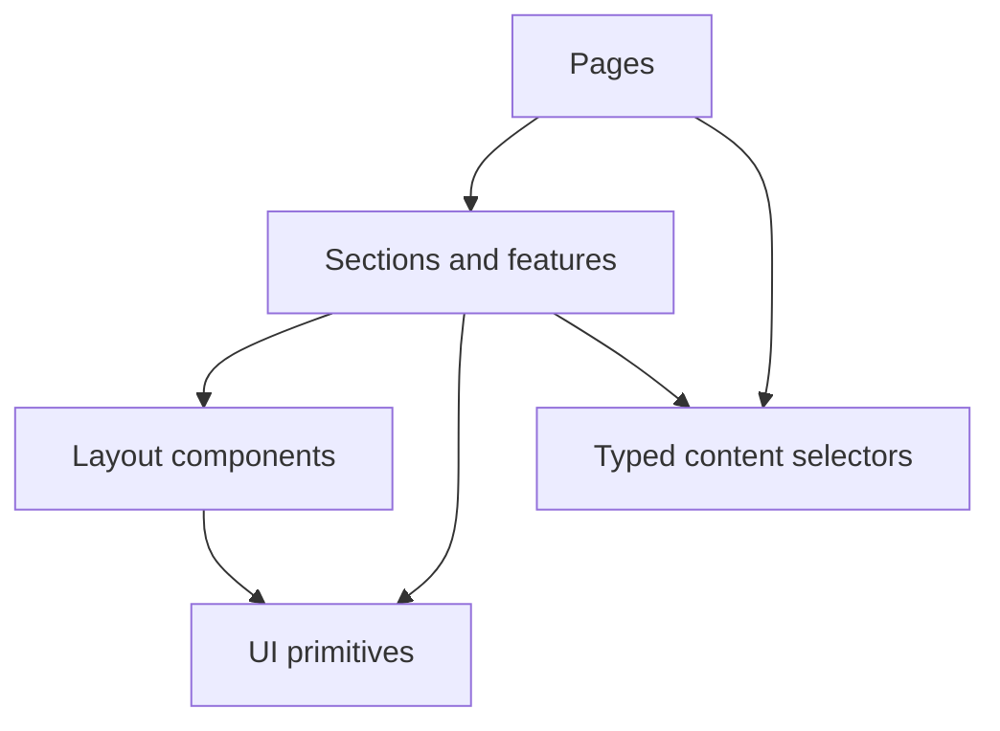

# Latifian.dev Technical Architecture

This document defines how `latifian.dev` is implemented, built, verified, and deployed. It is the canonical technical reference for contributors and AI coding agents.

Product intent and scope belong in `PRODUCTS.md`. Visual and interaction rules belong in `DESIGN.md`. Approved copy and content policy belong in `CONTENT.md`. Verified project facts and narratives belong under `content/projects/`. Work sequencing belongs in `IMPLEMENTATION_PLAN.md`. Operational verification begins as user-run manual checks and will be collected later in `QA.md`.

If this document conflicts with an implemented technical choice, do not silently preserve both. Either bring the implementation back into compliance or record and approve an architectural change here.

## 1. Architecture Goals

The architecture must support the following outcomes, in order:

1. **Crawlable evidence** — the homepage and every published case study produce complete HTML and page-specific metadata at build time.
2. **Content integrity** — project facts, localized narratives, and public links are validated before deployment.
3. **Accessible interaction** — the site works with semantic HTML, keyboard navigation, reduced motion, zoom, and assistive technology.
4. **Fast delivery** — readable content appears without waiting for a client-side data request or a large JavaScript bundle.
5. **Predictable maintenance** — visual tokens, components, content, and routes have clear ownership and dependency boundaries.
6. **Safe AI-agent changes** — an agent can identify the correct file to edit, make a narrow change, and run objective validation.
7. **Low operational overhead** — the initial product deploys as static files and does not require a database, application server, or CMS.

When these goals conflict, prefer accurate and accessible static content over novel client-side behavior.

### Release model

Public v1 is one complete bilingual release. The English-first vertical slice is an internal, local learning milestone only; it must not replace the existing public portfolio or enter a remote public preview. Every project in the production manifest requires validated English and Indonesian content.

Public v1 contains exactly three case studies, ordered on the homepage as FMS-CREATE, ReMi Mobile, and Semina. No card-only or fourth project enters the v1 production artifact.

The homepage Selected Work section is a curated preview with future capacity: it targets up to six landing slots but currently renders the three verified projects at every width. Item visibility beyond the current set uses stable CSS (`hidden lg:block`), never `window.innerWidth`, to keep markup identical for hydration and static generation. A curated project index (`/projects/`) is approved future scope; it must not ship before its detail routes are complete.

## 2. Constraints and Non-goals

### Required constraints

- Use React, TypeScript, and Vite.
- Use Tailwind CSS for composition and reusable utility styling.
- Express canonical design tokens as CSS custom properties; Tailwind consumes those variables rather than defining a competing palette.
- Support English and Indonesian.
- Support a homepage and reusable project case-study pages.
- Generate public pages as static HTML during the production build.
- Keep content in the repository and validate it at build time.
- Work on a static host with directory-index URLs and a custom `404.html`.
- Use npm and commit `package-lock.json`.
- Keep the core build hosting-provider neutral until a provider is approved.

### Technical non-goals for the initial release

- no database;
- no CMS;
- no authentication or user accounts;
- no application API;
- no server-side contact form;
- no runtime dependency on project-content APIs;
- no Redux, Zustand, or comparable global state library;
- no component library that replaces the canonical visual system;
- no MDX or executable code inside content files;
- no mandatory animation framework;
- no service worker or offline application shell unless separately approved;
- no dark mode until it becomes an approved product requirement.

## 3. Decision Summary

| Area | Decision | Reason |
|---|---|---|
| Rendering | Build-time static generation with React hydration | Gives case studies crawlable HTML and route-specific metadata while preserving React interactions |
| Client navigation | React Router | Stable nested routes, not-found handling, and locale-aware links |
| Language URLs | English at `/`; Indonesian under `/id/` | Keeps the default URL concise while giving Indonesian pages stable, shareable URLs |
| Content | Repository-owned YAML/Markdown validated with Zod | Human-readable, versioned, and usable without a CMS |
| Project prose | Plain Markdown rendered without raw HTML | Keeps authoring simple and prevents content files from executing UI code |
| Styling | CSS variables + Tailwind utilities + limited component CSS | Preserves the design system without arbitrary inline values |
| State | URL, component state, and a small locale preference utility | The product has no complex cross-page application state |
| Motion | CSS-first; Intersection Observer only for optional reveal | Small bundle, progressive enhancement, and simpler reduced-motion behavior |
| Tests | Static checks, focused unit tests, generated-output validation, and user-run manual browser checks | Fits manual-first learning while covering data logic, production output, and visible behavior |
| Deployment | Static `dist/` artifact | Minimal operations, broad hosting compatibility, and no server secrets |

### Package baseline

Use the smallest package set that implements these decisions. Pin resolved versions through `package-lock.json`; do not use documentation as a substitute for the lockfile.

**Application**

- `react` and `react-dom`;
- `react-icons` for the icon glyphs (imported directly from provider subpaths so only used icons enter the production bundle);
- `react-router-dom`;
- `react-helmet-async` for route-level head collection in server and browser rendering;
- `react-markdown` with `remark-gfm` for approved project prose.

**Build and content**

- `vite` and the official React plugin;
- `typescript` in strict mode;
- `tailwindcss` integrated through the supported Vite/PostCSS path for the installed version;
- `zod` for public-content schemas;
- `yaml` and `gray-matter` for content parsing;
- `sharp` for build-time image generation;
- `tsx` for typed build scripts.

**Quality, introduced when consumed**

- `eslint` with React, hooks, accessibility, and import-boundary rules;
- `vitest` and Testing Library;
- one formatter configured consistently across code, content data, and Markdown.

Do not add a package for behavior that can be expressed clearly in a small local utility. Conversely, do not create a fragile custom parser for a standard format merely to avoid a focused, maintained dependency.

## 4. System Context

`latifian.dev` has no required backend. All public content is converted into static pages during CI or a local production build.



External systems are destinations, not runtime data sources:

- email client through a `mailto:` link;
- LinkedIn and GitHub through normal external links;
- résumé as a versioned public asset or approved external URL;
- optional demo and repository links defined per project.

Failure of an external destination must not prevent the portfolio itself from rendering.

## 5. Rendering Strategy

### 5.1 Production model

The application uses a small custom static-generation pipeline based on Vite's client and SSR builds.

1. Validate content and build a typed content manifest.
2. Build the browser bundle with Vite.
3. Build an SSR entry with Vite.
4. Enumerate all public routes from the route and content manifests.
5. Render each route to HTML using React's server renderer.
6. Inject page-specific head metadata and serialized, non-sensitive initial content.
7. Write directory-index files to `dist/`.
8. Hydrate the generated markup in the browser for menus, locale switching, and enhanced navigation.

Conceptual output:

```text
dist/
├── index.html
├── 404.html
├── projects/
│   ├── fms-create/index.html
│   ├── remi-mobile/index.html
│   └── semina/index.html
├── id/
│   ├── index.html
│   └── projects/
│       ├── fms-create/index.html
│       ├── remi-mobile/index.html
│       └── semina/index.html
├── assets/
└── media/
```

### 5.2 Progressive enhancement

The initial HTML must contain:

- the page heading;
- primary navigation;
- all essential page copy;
- project metadata and case-study prose;
- contact links;
- image dimensions and alternative text;
- canonical, alternate-language, Open Graph, and description metadata.

JavaScript enhances navigation and interaction. It must not be required to discover the identity, selected work, experience, project evidence, or contact routes.

### 5.3 Hydration correctness

- Server and browser rendering must receive the same route, locale, and content manifest.
- Browser-only APIs may be accessed only inside effects or guarded utilities.
- Random values, current timestamps, and viewport-dependent markup must not affect the server-rendered tree.
- The copyright year may be generated at build time or supplied as stable content; it must not create a hydration mismatch.
- Decorative reveal states default to visible in generated HTML.

### 5.4 Development model

The Vite development server may render as a normal client application for fast feedback. Production correctness is verified against the static output, not inferred from dev mode.

Local development may expose validated draft content to support the English-first learning milestone. Draft content must never enter a production manifest, browser bundle, generated route, sitemap, metadata record, or remote public preview.

Before completing route, metadata, locale, or content-loading work, an agent must run the production build and inspect the relevant generated HTML.

## 6. Routing and URL Design

### 6.1 Public routes

| Purpose | English | Indonesian |
|---|---|---|
| Homepage | `/` | `/id/` |
| Projects index (approved future) | `/projects/` | `/id/projects/` |
| FMS-CREATE | `/projects/fms-create/` | `/id/projects/fms-create/` |
| ReMi Mobile | `/projects/remi-mobile/` | `/id/projects/remi-mobile/` |
| Semina | `/projects/semina/` | `/id/projects/semina/` |
| Not found | generated `404.html` | English recovery content with `noindex` |

Trailing-slash directory URLs are canonical because they map directly to static `index.html` files.

Public v1 currently has exactly eight indexable routes: two homepages and six localized case studies. `404.html` is generated but is not indexable and never enters the sitemap. Adding the list-oriented project index later adds two indexable routes and requires the route-count validator to be updated in the same change.

### 6.2 Locale behavior

- English is the default locale and uses unprefixed routes.
- Indonesian always uses the `/id/` prefix.
- The language switch maps to the equivalent page and slug in the other locale.
- A missing translation for published content is a production build failure. Published routes never fall back to another page or mixed-language content.
- A deliberate language selection may be saved to local storage for the switch's future default, but it must not silently redirect a shared URL.
- `<html lang>` is set to the active locale.
- Every translated page publishes `hreflang="en"`, `hreflang="id"`, and an appropriate `x-default` URL.

### 6.3 Anchor navigation

Homepage sections use stable IDs:

```text
#about
#projects
#experience
#skills
#contact
```

Links from case studies to homepage sections use locale-aware absolute paths, for example `/id/#contact`. A sticky header must not obscure the target; apply `scroll-margin-top` through a shared token.

### 6.4 Slugs

- Slugs use lowercase ASCII kebab-case.
- A slug represents the same project in both locales.
- Published slugs are treated as stable identifiers.
- A renamed slug requires a redirect plan on the selected host.
- Route components never derive a title or project identity from a slug; they resolve a validated content record.

Public-v1 stable slugs are `fms-create`, `remi-mobile`, and `semina`. Changing one after publication requires a redirect plan in the selected host adapter.

### 6.5 Unknown routes and missing content

- Unknown routes render a branded not-found page with routes to Home, Projects, and Contact.
- An unknown project slug must return not-found content, not a blank case-study template.
- Optional project fields are omitted cleanly; required-field failures stop the build.
- `404.html` has a title, language, one `h1`, recovery links, and `noindex`; it does not require canonical or reciprocal locale metadata intended for indexable routes.

## 7. Repository Structure

The target structure is:

```text
porto-latifiann/
├── AGENTS.md
├── README.md
├── package.json
├── package-lock.json
├── vite.config.ts
├── tsconfig.json
├── eslint.config.js
├── index.html
├── docs/
│   ├── PRODUCTS.md
│   ├── DESIGN.md
│   ├── CONTENT.md
│   ├── ARCHITECTURE.md
│   ├── IMPLEMENTATION_PLAN.md
│   ├── QA.md
│   ├── references/
│   │   ├── homepage-desktop-1280.png
│   │   └── homepage-mobile-390.png
│   └── adr/
├── content/
│   ├── site/
│   │   ├── site.yaml
│   │   ├── en.yaml
│   │   └── id.yaml
│   │   ├── media/
│   │   │   └── portrait/
│   │   │       └── latifian-iman-portrait.webp
│   │   └── fonts/
│   │       ├── geist/
│   │       │   └── source/
│   │       ├── instrument-serif/
│   │       │   └── source/
│   │       └── jetbrains-mono/
│   │           └── source/
│   ├── experience.yaml
│   ├── capabilities.yaml
│   └── projects/
│       ├── fms-create/
│       │   ├── project.yaml
│       │   ├── en.md
│       │   ├── id.md
│       │   └── media/
│       ├── remi-mobile/
│       │   ├── project.yaml
│       │   ├── en.md
│       │   ├── id.md
│       │   └── media/
│       └── semina/
│           ├── project.yaml
│           ├── en.md
│           ├── id.md
│           └── media/
├── public/
│   ├── favicon.svg
│   ├── manifest.webmanifest
│   ├── generated/
│   │   └── media/
│   │   └── fonts/
│   └── resume/
├── scripts/
│   ├── build-content.ts
│   ├── generate-static.ts
│   ├── generate-images.ts
│   └── validate-dist.ts
├── src/
│   ├── app/
│   │   ├── App.tsx
│   │   ├── routes.tsx
│   │   ├── route-manifest.ts
│   │   └── providers.tsx
│   ├── components/
│   │   ├── ui/
│   │   ├── layout/
│   │   └── sections/
│   ├── features/
│   │   ├── locale/
│   │   └── projects/
│   ├── generated/
│   │   └── content-manifest.ts
│   ├── pages/
│   │   ├── HomePage.tsx
│   │   ├── ProjectPage.tsx
│   │   └── NotFoundPage.tsx
│   ├── styles/
│   │   ├── tokens.css
│   │   ├── fonts.css
│   │   └── globals.css
│   ├── lib/
│   ├── types/
│   ├── entry-client.tsx
│   └── entry-server.tsx
├── tests/
│   ├── unit/
│   ├── integration/
│   └── e2e/
└── dist/
```

This tree describes the target end state, not folders that must be created in advance. Create a directory, package, script, or abstraction only when the active vertical slice consumes it. Do not create empty component categories or install the entire package baseline before use.

`src/generated/` and `dist/` are build outputs. They must not be edited manually. Whether generated manifests are committed should be decided once and enforced consistently; the recommended default is to ignore them and regenerate in validation and build commands.

`public/generated/media/` is also generated and ignored. The image step writes optimized variants there before the Vite client build copies them into `dist/media/` or another single documented public path. It must clean only its own generated directory and never delete hand-authored files from `public/`.

### Documentation filename normalization

Canonical product documents live under `docs/`. The previous `agent-integrations/` location was review staging and must not retain competing canonical copies after normalization.

Before feature implementation starts, `docs/PRODUCTS.md`, `docs/DESIGN.md`, `docs/CONTENT.md`, `docs/ARCHITECTURE.md`, `docs/IMPLEMENTATION_PLAN.md`, and root `AGENTS.md` must exist and agree on release scope. `docs/QA.md` is deferred and will grow from verified manual checks.

## 8. Content Architecture

### 8.1 Ownership

| Content | Canonical owner |
|---|---|
| Product scope and audience | `docs/PRODUCTS.md` |
| Voice, approved global copy, and terminology | `docs/CONTENT.md` |
| Canonical origin and locale-independent site facts | `content/site/site.yaml` |
| Shared project facts | `content/projects/<slug>/project.yaml` |
| English project narrative | `content/projects/<slug>/en.md` |
| Indonesian project narrative | `content/projects/<slug>/id.md` |
| Executable homepage strings | `content/site/<locale>.yaml` |
| Experience entries | `content/experience.yaml` |
| Capability groups | `content/capabilities.yaml` |

`CONTENT.md` is the editorial approval and writing-policy document. Production strings must live in the structured content files so the application consumes the same values that are reviewed and validated. `CONTENT.md` must reference content keys rather than duplicate full live strings after the content migration is complete.

### 8.2 Project record

`project.yaml` contains locale-independent facts and media metadata. Example shape:

```yaml
schemaVersion: 1
slug: remi-mobile
publication: draft
homepageOrder: 2
status: ongoing
maintenance: unmaintained
year: 2026
category: Mobile productivity
roles:
  - Mobile Engineer
stack:
  - Flutter
repository:
  visibility: private
  url: null
demoUrl: null
media:
  hero:
    source: ./media/hero.png
    aspectRatio: 1.6
    focalPosition: center
```

Localized Markdown begins with validated front matter:

```yaml
---
locale: en
title: ReMi Mobile
summary: A concise verified project summary.
roleSummary: Mobile and frontend engineering contribution.
seoDescription: A page-specific description within the documented limit.
mediaAlt:
  hero: Fleet management interface showing vehicle operations.
---
```

The example values illustrate shape only and are not approved production facts. The Markdown body uses a supported section vocabulary such as Context, Problem, Responsibilities, Approach, Technical Decisions, Challenges, Outcome, and Reflection. A project does not need empty sections merely to match the template.

`publication` has two values:

- `draft`: may have only `en.md`, is visible only in local development, and is excluded from production routes and artifacts;
- `published`: requires both `en.md` and `id.md` and participates in production routes, selected work, metadata, and sitemap generation.

`homepageOrder` is `1`, `2`, `3`, or `null`. It is the single source of selected-work order; public v1 uses FMS-CREATE `1`, ReMi Mobile `2`, and Semina `3`. Repository visibility controls only whether a source link may be exposed; it does not control case-study publication.

`maintenance` is an optional public status qualifier: `maintained`, `unmaintained`, or `null`. It qualifies lifecycle status without replacing it. For example, ReMi Mobile uses `status: completed` and `maintenance: unmaintained`.

### 8.3 Markdown safety

- Raw HTML is disabled.
- MDX imports and JSX are not supported.
- Only approved Markdown elements and plugins are enabled.
- External links receive safe attributes through the renderer.
- Heading levels are normalized beneath the page's single `h1`.
- Content images must resolve through the project media registry; arbitrary remote embeds are rejected by default.

### 8.4 Schema validation

Zod schemas validate content in two modes.

**Development validation** permits incomplete locale coverage only for `draft` projects while still validating every available field, URL, media reference, and Markdown structure.

**Production validation** excludes drafts and requires complete English and Indonesian content for every `published` project. Public v1 must contain exactly the three approved slugs and homepage order.

Validation includes:

- required fields and allowed enum values;
- unique project slugs;
- unique experience IDs;
- locale completeness according to publication state and validation mode;
- valid public URLs;
- date and year formats;
- allowed project statuses;
- referenced media existence;
- nonempty alternative text for meaningful images;
- no public URL when repository visibility is private;
- homepage ordering without duplicates or gaps;
- the exact public-v1 slug set: `fms-create`, `remi-mobile`, and `semina`;
- canonical origin equality with `https://latifian.dev`;
- no unsupported Markdown heading structure.

Builds fail with file path, content key, and actionable error text. Validation must not replace missing facts with defaults that could misrepresent the project.

### 8.5 Generated content manifest

`scripts/build-content.ts` converts validated sources into one deterministic, typed manifest consumed by both server and browser entries. Production generation includes only `published` content.

The generated manifest contains only public information. It must not include draft notes, evidence comments, private URLs, credentials, unpublished contact data, or file-system paths.

## 9. Type and Domain Model

Domain types live under `src/types/` and reflect validated content rather than component props.

Core concepts include:

```ts
type Locale = 'en' | 'id'

type ProjectStatus = 'ongoing' | 'completed' | 'prototype' | 'archived'

type PublicationState = 'draft' | 'published'

type MaintenanceState = 'maintained' | 'unmaintained' | null

interface LocalizedPage<T> {
  locale: Locale
  value: T
}

interface ProjectSummary {
  slug: string
  title: string
  summary: string
  timeline: ProjectTimeline
  status: ProjectStatus
  maintenance: MaintenanceState
  publication: PublicationState
  homepageOrder: 1 | 2 | 3 | null
  roles: string[]
  stack: string[]
  hero: ProjectMedia
}

interface ProjectTimeline {
  start: string
  end: string | null
  ongoing: boolean
  display: string
}

interface ProjectDetail extends ProjectSummary {
  roleSummary: string
  body: ProjectSection[]
  links: ProjectLinks
  media: Record<string, ProjectMedia>
}
```

Rules:

- Never use `any` for content or route data.
- Do not use a type assertion to bypass a failed content parse.
- Prefer discriminated unions for optional public links and media types.
- Separate domain records from presentational component props.
- Keep localized text out of locale-independent fact records.
- Keep publication state distinct from repository visibility.

## 10. Component Architecture

### 10.1 Dependency direction



Allowed dependency rules:

- `pages` may compose sections, features, layout, and UI primitives.
- `sections` may use features, layout, UI primitives, and public domain types.
- `features` own project and locale behavior and may use UI primitives.
- `layout` and `ui` must not import page components or project-specific content.
- Content parsing and Node-only generation code must never enter the browser bundle.
- A reusable component must not read global content implicitly; receive the smallest required typed props.

### 10.2 Component categories

**UI primitives**

- Button
- TextLink
- Badge
- Icon
- FocusRing behavior
- VisuallyHidden
- ResponsiveImage

**Layout**

- SiteHeader
- SiteFooter
- PageContainer
- Section
- SectionHeader
- Grid
- SkipLink

**Homepage sections**

- HeroSection
- EngineeringStatement
- SelectedWorkSection
- ExperienceSection
- CapabilitiesSection
- TechnologyStrip
- ContactSection

**Project feature**

- ProjectCard
- ProjectMetadata
- ProjectHero
- ProjectSectionRenderer
- ProjectNavigation

Create a new abstraction only when at least two real consumers share behavior or structure. Do not build a speculative component system before the first complete page exists.

### 10.3 Semantic requirements

- Each page has one `h1`.
- Section headings follow a logical hierarchy.
- Navigation uses real links.
- Buttons perform actions; links navigate.
- Project cards do not contain invalid nested interactive elements.
- Decorative icons and images are hidden from assistive technology.
- Case-study prose remains readable when styles or JavaScript fail.

## 11. State Management

The product's state is deliberately small.

### URL-owned state

- current route;
- project slug;
- active locale;
- homepage anchor;
- future project filters, if approved.

### Component-owned state

- mobile navigation open/closed;
- disclosure state where semantically justified;
- image loading or error presentation;
- temporary focus and hover behavior.
- temporary theme-preview toast visibility.

### Persisted preference

Only an explicit locale choice may be persisted in local storage. The site must remain correct when storage is unavailable or cleared. The v1 theme-preview button is component-local feedback only: it does not change tokens, persist a preference, or create dark-mode state.

React Context may provide the resolved locale and localized link helpers. Do not add a global state package unless a future feature demonstrates cross-route state that cannot be expressed cleanly through the URL, content manifest, or a narrow provider.

## 12. Styling Architecture

### 12.1 Token source

`src/styles/tokens.css` implements the canonical tokens from `DESIGN.md` as CSS custom properties.

Example:

```css
:root {
  --color-canvas: #ffffff;
  --color-surface: #f8fafc;
  --color-ink: #0f172a;
  --color-primary: #2563eb;
  --color-border: #e2e8f0;
  --radius-sm: 0.5rem;
  --radius-md: 0.75rem;
  --space-section: clamp(4rem, 8vw, 8rem);
}
```

Tailwind theme aliases point to these variables. A component may use `bg-canvas`, `text-ink`, and `border-border`; it must not introduce near-duplicate hex values.

### 12.2 Styling rules

- Prefer Tailwind utilities for layout, spacing, typography, and common states.
- Use CSS modules or colocated component CSS only for compositions that are clearer in named CSS, such as hero overlaps or rich Markdown flow.
- Keep global CSS limited to reset, tokens, font faces, base element behavior, accessibility helpers, and shared prose rules.
- Avoid arbitrary Tailwind values unless representing a documented one-off media ratio or measured positioning requirement.
- Repeated arbitrary values must become tokens or component variants.
- Do not compute essential layout solely from JavaScript viewport measurements.

### 12.3 Fonts

- Retain licensed TTF source files and notices under `content/site/fonts/<family>/source/`, then generate self-hosted WOFF2 files for all three canonical font families under `public/generated/fonts/`. If licensing prevents self-hosting, stop implementation and obtain an approved font decision rather than falling back to a remote CDN.
- Variable font families (Geist, JetBrains Mono) are converted to a single variable WOFF2 per family and declared with a `font-weight` range that matches the `wght` axis. Do not generate multiple static filenames from the same variable source.
- Load only the weights used by the design system.
- Preload only the font files required above the fold.
- Use `font-display: swap`.
- Define resilient fallback stacks that minimize layout shift.
- Disable `font-synthesis` for the product font roles so the browser does not invent synthetic weights.
- Geist, Instrument Serif, and JetBrains Mono are the only product font roles.

### 12.4 Responsive behavior

Use the canonical breakpoints from `DESIGN.md`:

- mobile: below 768px;
- tablet: 768–1023px;
- desktop: 1024px and above.

Mobile is an intentional composition, not a scaled desktop canvas. Components should default to mobile layout and add complexity at larger breakpoints. Content order must remain logical in the DOM even where desktop visuals overlap or alternate.

## 13. Media Pipeline

### 13.1 Source and generated assets

- Original project media stays beside its project content.
- Owner-provided hero portrait source stays at `content/site/media/portrait/`.
- Licensed source fonts and notices stay under `content/site/fonts/` by family.
- `scripts/generate-fonts.ts` generates only browser-used WOFF2 files under `public/generated/fonts/` (one variable WOFF2 per variable family plus the static italic); `npm run fonts:generate` runs before the Vite production build; source TTF files never load directly in production.
- Approved Stitch reference captures stay under `docs/references/` and are excluded from source manifests and production output.
- `scripts/generate-images.ts` produces web-ready AVIF and WebP variants plus a fallback where justified.
- Generated filenames include a content hash.
- Components receive a media manifest, not guessed file paths.
- SVG is reserved for trusted repository-owned vectors; user-authored SVG is reviewed before publication.

### 13.2 Responsive images

The `ResponsiveImage` component owns:

- `srcset` and `sizes`;
- intrinsic width and height;
- aspect-ratio reservation;
- `loading` and fetch priority;
- alternative text;
- crop or contain behavior;
- graceful missing-image presentation.

The hero portrait may load eagerly with appropriate priority. Below-the-fold project imagery is lazy-loaded. Do not lazy-load the visual expected to become the page's Largest Contentful Paint element.

### 13.3 Image rules

- Never upscale a low-resolution source merely to fill a desktop container.
- Preserve critical UI edges in screenshots.
- Do not encode text only inside images.
- Animated media is optional, muted, and never required to understand the project.
- Remote hotlinking is disallowed by default.

### 13.4 Technology icons

Trusted grayscale brand SVG marks for the Technology strip live locally under `public/technology-icons/`. A local provenance note and license record stay beside them in `README.md`.

- Exact filename mapping used by `src/components/sections/TechnologyStrip.tsx`:
  - Flutter → `flutter.svg`;
  - Dart → `dart.svg`;
  - React → `react.svg`;
  - TypeScript → `typescript.svg`;
  - JavaScript → `js.svg`;
  - HTML5 → `html5.svg`;
  - CSS3 → `css3.svg`;
  - Tailwind CSS → `tailwindcss.svg`;
  - Node.js → `nodejs.svg`;
  - Express → `expressjs.svg`;
  - Java → `java.svg`;
  - PostgreSQL → `postgresql.svg`;
  - MySQL → `mysql.svg`;
  - MongoDB → `mongodb.svg`;
  - Docker → `docker.svg`;
  - Git → `git.svg`;
  - GitHub → `github.svg`;
  - Figma → `figma.svg`.
- Remote hotlinking of icon assets is disallowed.
- The icons are third-party (`tech-stack-icons`, MIT); provenance and license must be retained.
- Before publication each SVG is reviewed to contain no script, event handler, external URL, embedded raster, or `foreignObject`.
- A missing or failed icon is hidden at runtime; the visible technology label must never be blocked or hidden as a consequence.

## 14. Interaction and Motion

CSS transitions implement buttons, links, image scale, arrow movement, and simple entrance states. A small Intersection Observer utility may add `data-visible` to logical reveal groups.

Rules:

- Content is visible by default before enhancement.
- The observer does not create one instance per decorative element when groups can share it.
- No continuous animation is required for navigation or comprehension.
- `prefers-reduced-motion: reduce` disables reveal transforms, marquees, smooth scrolling, and nonessential transitions.
- Do not introduce Framer Motion or GSAP for effects already covered by `DESIGN.md`.
- Adding a motion library requires an architecture update and a measured bundle justification.

## 15. Metadata, SEO, and Sharing

Metadata is generated per static route from typed content.

The sole production canonical origin is `https://latifian.dev`, stored as a locale-independent site fact in `content/site/site.yaml`. A hosting environment may expose another deployment URL but must not replace the canonical origin used by metadata, sitemap, alternate-language links, `x-default`, or structured data. Production builds fail when the configured origin is missing or differs.

Every public page includes:

- unique `<title>`;
- unique meta description;
- canonical URL;
- alternate-language links;
- Open Graph title, description, type, URL, locale, and image;
- Twitter card metadata;
- correct document language;
- crawlable page heading and summary.

Structured data:

- Homepage may use `Person` and `WebSite` JSON-LD when all fields are accurate.
- Case studies may use `CreativeWork` or `SoftwareApplication` only when the schema truthfully fits the project.
- Do not publish rating, organization, employment, or product claims solely to fill a schema field.

`sitemap.xml` and `robots.txt` are generated from the same public route manifest. Draft projects never enter the route manifest, sitemap, or client bundle. A published case study may describe a project with a private repository, but no private repository URL enters public output.

## 16. Accessibility Architecture

Accessibility is enforced across components, content, static checks, and user-run manual review during current learning phase.

Required foundations:

- semantic landmarks and one logical page heading;
- skip link to main content;
- visible `:focus-visible` styling;
- 44px target size where possible;
- accessible menu naming and state;
- focus return when mobile navigation closes;
- sufficient contrast from canonical tokens;
- no color-only, position-only, or motion-only meaning;
- meaningful image alternatives;
- reduced-motion support;
- content usable at 200% zoom and narrow reflow;
- locale-correct `lang` attributes;
- descriptive external-link text.

During current learning phase, Latifian performs manual checks for homepage, case-study routes, mobile navigation, and not-found behavior. Playwright and automated axe checks are deferred until later explicit quality phase, unless Latifian explicitly requests them for a task. Manual success does not replace future release accessibility review.

## 17. Error Handling and Resilience

### Build-time failures

The build must stop for:

- invalid content schema;
- duplicate or illegal slugs;
- missing required locale content;
- missing required media;
- private URLs exposed as public links;
- unresolved internal routes;
- generation or prerender failures;
- generated HTML without a page title or `h1`.

### Runtime degradation

- Missing optional media shows a quiet fallback without hiding project text.
- Failed fonts fall back to system-appropriate stacks.
- Failed JavaScript leaves the static document readable and links usable.
- External-link failure does not trigger an application error boundary.
- A top-level error boundary may provide recovery for hydrated client failures, but it must not replace correctly generated static content.

No error report may expose source paths, content drafts, environment values, or stack traces to visitors.

## 18. Security and Privacy

The static architecture reduces attack surface but does not remove security responsibilities.

- Do not place secrets in `VITE_*` environment variables; all such values are public in the browser bundle.
- Do not commit credentials, private repository URLs, personal addresses, or internal infrastructure details.
- Sanitize or disallow raw HTML from content.
- Add `rel="noopener noreferrer"` where appropriate for external new-tab links.
- Use a restrictive Content Security Policy compatible with self-hosted assets.
- Avoid third-party scripts by default.
- If analytics is approved, prefer a privacy-conscious provider, document collected data, and load it without blocking primary content.
- Keep dependencies minimal and review lockfile changes.
- Treat contact email exposure as an explicit public-content decision.

Security headers are configured on the host when supported: CSP, `X-Content-Type-Options`, `Referrer-Policy`, and a conservative `Permissions-Policy`.

## 19. Performance Architecture

### Experience targets

Target the 75th percentile on representative mobile conditions:

- LCP at or below 2.5 seconds;
- CLS at or below 0.1;
- INP at or below 200 milliseconds.

These are targets to measure, not claims to publish before testing.

### Build budgets

- initial route JavaScript: target at or below 170 KiB gzip;
- initial CSS: target at or below 50 KiB gzip;
- hero image: target at or below 250 KiB at its common mobile size;
- no uncompressed multi-megabyte screenshot in the public build;
- no blocking third-party script in the document head.

Budget exceptions require evidence, a documented reason, and a follow-up action.

### Techniques

- static HTML for immediate readable content;
- route-level code splitting where it produces a measurable benefit;
- self-hosted subset fonts;
- responsive generated imagery;
- explicit dimensions to avoid layout shift;
- lazy loading below the fold;
- CSS-first effects;
- no runtime request for local portfolio content;
- hashed assets with immutable caching.

## 20. Testing Strategy

### 20.1 Static analysis

- TypeScript strict mode;
- ESLint with React, hooks, accessibility, and import-boundary rules;
- formatting through Prettier or the formatter selected during initialization;
- content-schema validation;
- production build and generated-output validation.

### 20.2 Unit tests

Use Vitest for:

- locale-aware URL helpers;
- project selectors and sorting;
- schema refinements;
- metadata generation;
- route enumeration;
- safe Markdown transformation;
- media-manifest behavior.

### 20.3 Component and integration tests

Use Testing Library for behavior rather than implementation details:

- language switch keeps the equivalent route;
- navigation state and accessible naming;
- project card link and metadata rendering;
- optional links are omitted correctly;
- project content renders the expected heading hierarchy;
- responsive image attributes are correct;
- not-found content offers recovery routes.

### 20.4 Manual browser checks

Latifian tests UI behavior manually during current learning phase. Agent supplies exact route, viewport widths, mouse and keyboard actions, then records user-reported outcome unless Latifian explicitly requests automation; if requested, the automation result is reported as automation and does not stand in for a user manual outcome.

Manual coverage grows across:

- English and Indonesian homepage journeys;
- direct project-route entry and locale switching;
- keyboard navigation and mobile-menu behavior;
- anchor links and 404 recovery;
- horizontal overflow, reduced motion, and 200% zoom;
- essential content when JavaScript is unavailable, when practical.
- side-by-side review against approved Stitch references at desktop `1280px` and mobile `390px` after final fonts and media are available.

Future `docs/QA.md` turns repeated manual checks into maintained release cases. Manual side-by-side reference review is allowed and distinct from automated visual screenshot baselines. Playwright and axe may be used when the owner explicitly requests them; automated visual screenshot baselines remain deferred. None are current learning-phase gates.

### 20.5 Generated-output tests

`scripts/validate-dist.ts` verifies:

- exactly eight indexable public routes have HTML files;
- every indexable HTML file has title, description, canonical URL under `https://latifian.dev`, `lang`, and one `h1`;
- locale alternate links are reciprocal;
- the sitemap contains exactly those eight indexable URLs and excludes `404.html`;
- `404.html` contains a title, language, one `h1`, recovery links, and `noindex`;
- referenced local assets exist;
- no fourth project, draft marker, private URL, source path, credential, or unpublished content key appears in `dist/`;
- generated pages do not depend on a client request for primary content.

## 21. Commands and Build Pipeline

The finalized repository must expose these stable npm scripts, even if their internal implementation changes:

```json
{
  "scripts": {
    "dev": "vite",
    "content:validate": "tsx scripts/build-content.ts --check",
    "content:build": "tsx scripts/build-content.ts",
    "images:build": "tsx scripts/generate-images.ts",
    "typecheck": "tsc --noEmit",
    "lint": "eslint .",
    "test": "vitest run",
    "build:client": "vite build",
    "build:ssr": "vite build --ssr src/entry-server.tsx --outDir dist-ssr",
    "build:static": "tsx scripts/generate-static.ts",
    "build:validate": "tsx scripts/validate-dist.ts",
    "build": "npm run content:build && npm run images:build && npm run build:client && npm run build:ssr && npm run build:static && npm run build:validate",
    "preview": "vite preview"
  }
}
```

The exact generator may require minor command changes during implementation. Preserve the public script names by public v1 so agents and CI have a stable contract. Early learning commits need only expose scripts they actively use. Command changes must not replace custom build-time static generation with SPA-only rendering or provider-specific prerendering.

Recommended CI order:

```text
npm ci
→ content validation
→ lint
→ typecheck
→ unit/component tests
→ production build
→ generated-output validation
→ user-run manual browser checks documented for active change
→ deploy immutable artifact
```

CI and local commands use the same build path. Deployment must never use a separately assembled artifact.

## 22. Deployment Architecture

The deployable unit is the validated `dist/` directory.

Hosting-provider selection is deferred. The core build is provider neutral and must not import a provider SDK. Provider-specific redirects, response headers, caching, deployment workflow, preview behavior, and atomic promotion are thin adapters added only after provider selection. Directory-index HTML and `404.html` generation remain core responsibilities.

### Host selection and adapter requirements

- HTTPS and custom-domain support;
- directory-index static serving;
- custom `404.html`;
- redirect support for any future slug changes;
- configurable cache and security headers;
- atomic deployments or versioned releases;
- no requirement for a Node process after build.

If a candidate host cannot provide a mandatory capability, either reject the host or record an explicit exception and mitigation before deployment.

### Cache policy

- hashed assets: long-lived immutable cache;
- HTML: short cache or revalidation so content updates propagate;
- résumé and social images: versioned filename when long-lived caching is used;
- `sitemap.xml` and `robots.txt`: short cache or revalidation.

### Environment configuration

Only public build configuration is allowed, such as:

- deployment environment name;
- an explicitly approved analytics site ID.

The canonical site origin comes from validated repository content and must equal `https://latifian.dev`; a host environment must not silently override it. No environment value should be considered secret in a static Vite build.

## 23. Observability and Maintenance

The initial site does not require application logs or runtime tracing.

Recommended operational signals:

- deployment status;
- uptime and TLS monitoring;
- broken-link checks;
- Lighthouse or Web Vitals checks in scheduled CI;
- privacy-conscious aggregate traffic only if explicitly enabled.

Do not add a large monitoring SDK merely to collect client errors for a static portfolio. If a future integration is added, document its privacy impact, payload, bundle cost, and removal procedure.

Maintenance cadence should include:

- verify public contact and résumé links before a release;
- review project status and availability statements;
- apply dependency updates in small, tested batches;
- remove unused media and components;
- test supported browsers and representative devices;
- inspect the public build for accidental private content.

## 24. Architectural Decision Records

Major architectural changes require a short record under `docs/adr/`.

Use this format:

```text
# ADR-NNN: Decision title

Status: proposed | accepted | superseded
Date: YYYY-MM-DD

## Context
## Decision
## Consequences
## Alternatives considered
```

Initial accepted decisions represented by this document:

### ADR-001 — Static generation over SPA-only rendering

Accepted because project pages require crawlable content, social metadata, direct entry, and graceful operation without JavaScript. An SPA-only build is simpler but does not reliably satisfy those requirements.

### ADR-002 — Repository content over a CMS

Accepted because the initial portfolio has one owner, infrequent updates, and strong version-control needs. A CMS would add authentication, runtime dependencies, and operational scope without sufficient benefit.

### ADR-003 — English unprefixed and Indonesian prefixed

Accepted to preserve a concise default URL while keeping every Indonesian page stable and shareable. Automatic locale redirection is rejected because it makes shared links unpredictable.

### ADR-004 — CSS-first motion

Accepted because the intended interactions are restrained and do not justify a general animation runtime. A motion library remains possible only after a measured need.

### ADR-005 — No general global state store

Accepted because route, locale, and menu state have clear owners. Adding a store now would increase indirection without solving a real product problem.

### ADR-006 — Complete bilingual public v1 with an internal English-first milestone

Accepted because learning and delivery can proceed through a small English vertical slice without weakening the public locale contract. Draft English-only content remains local; published content requires both locales.

### ADR-007 — Host-neutral core with deferred provider adapters

Accepted because the production host is undecided. The validated `dist/` artifact remains portable while redirects, headers, caching, and deployment syntax stay isolated in a later adapter.

### ADR-008 — History-preserving cutover into `porto-latifiann`

Accepted because the existing public repository and its history remain valuable. The new implementation will replace its working tree through normal commits only after release approval.

## 25. Implementation Sequence

This is the architectural dependency order, not a replacement for `IMPLEMENTATION_PLAN.md`.

1. Complete documentation foundation: `PRODUCTS.md`, `DESIGN.md`, `CONTENT.md`, `ARCHITECTURE.md`, `IMPLEMENTATION_PLAN.md`, and `AGENTS.md`. Defer `QA.md` until manual checks establish useful cases.
2. Establish the repository and tooling foundation.
3. Implement canonical tokens, self-hosted fonts, semantic page shell, and accessibility helpers.
4. Complete small React learning units: typed `ProjectMetadata`, `ProjectCard`, and `SelectedWorkSection`.
5. Build the local English ReMi Mobile vertical slice with real, verified content.
6. Add its Indonesian equivalent and strict publication validation.
7. Add the route model, locale-aware links, client/server entries, and static route generation.
8. Add FMS-CREATE and Semina through the same content schema and renderer.
9. Complete homepage sections, media generation, and responsive images.
10. Add metadata, sitemap, robots, structured data where truthful, and `404.html`.
11. Complete production-output validation, focused tests, manual review, performance review, and accessibility review.
12. Select a static host, add its thin adapter, and run post-deploy verification.
13. Perform the history-preserving cutover into `porto-latifiann`.

The first English slice is local and non-releaseable. Add its Indonesian equivalent before multiplying projects or producing a public artifact. ReMi Mobile is the learning vertical slice even though homepage ordering remains FMS-CREATE, ReMi Mobile, then Semina.

### 25.1 Learning workflow

Latifian is learning React. Initial implementation is divided into small, production-relevant units. Latifian authors the first attempt; the agent supplies the objective and acceptance criteria, reviews correctness, explains issues, and proposes narrow changes. The agent must not replace the attempt unless explicitly asked. Each unit must be small enough to validate with one focused test or browser check.

Packages, directories, scripts, and abstractions are introduced when first consumed. Do not scaffold the complete end-state tree before the active vertical slice needs it.

### 25.2 Repository transition and cutover

The existing portfolio remains publicly available until the complete bilingual v1 artifact passes every release gate. Current development under `personal-portofolio/` must not alter the live deployment.

At cutover, replace the working tree of the existing `porto-latifiann` repository through normal commits on its existing history. Do not reinitialize `.git`, create an orphan branch, force-push, or replace repository history. Record the final old-site commit or deployment as a rollback point, inventory existing public URLs, and assign each one a retain, redirect, or explicit removal decision. Pre-replacement commits must remain reachable after cutover.

The current local `personal-portofolio/` directory is not a Git repository. The current live repository is `vcard-personal-portfolio/`, uses branch `main`, and tracks `https://github.com/latifiann/porto-latifiann.git`. Existing `.DS_Store` modifications in the live repository are unrelated and must not be changed without a separate decision.

## 26. AI Coding Agent Contract

An AI agent working on `latifian.dev` MUST:

- read `AGENTS.md`, `docs/PRODUCTS.md`, `docs/DESIGN.md`, `docs/CONTENT.md`, `docs/ARCHITECTURE.md`, and the relevant project source before changing implementation;
- honor the learning workflow by reviewing Latifian's first attempt before replacing it;
- preserve static generation for every public page;
- keep content parsing and file-system access out of the browser bundle;
- use the validated content manifest instead of embedding project facts in components;
- preserve locale-aware, shareable URLs;
- use canonical design tokens and existing component patterns;
- maintain semantic HTML, keyboard behavior, and reduced-motion support;
- add or update focused static tests for routing, schemas, and behavior it changes when testing infrastructure exists;
- run available content validation, lint, typecheck, tests, and production build when relevant;
- inspect generated HTML when changing routes, metadata, localization, or rendering;
- make the smallest coherent change and avoid unrelated refactors;
- document a reusable architectural change here or in an ADR.

An AI agent MUST NOT:

- convert the site to SPA-only rendering;
- add a backend, database, CMS, contact service, analytics, or authentication without explicit approval;
- invent content defaults to satisfy a failing schema;
- duplicate factual project data across UI components;
- place private evidence or draft notes in the public manifest;
- expose a draft through a production route, sitemap, client bundle, or remote public preview;
- add a state library, UI framework, or animation library without a demonstrated need;
- use raw HTML from Markdown;
- hard-code locale-dependent links;
- introduce a second token system or arbitrary visual values;
- bypass TypeScript or schema failures with `any`, unchecked assertions, or disabled rules;
- report UI behavior or quality targets as achieved without corresponding static checks and user-reported manual verification.

When requirements are ambiguous, the agent should protect content truth, static readability, accessibility, and the established design before optimizing implementation convenience.

## 27. Definition of Done

A technical change is complete only when all relevant conditions are true:

- the implementation matches the approved product scope;
- public routes generate valid static HTML;
- content passes schemas without fabricated fallback values;
- English and Indonesian behavior remains internally consistent;
- direct route entry and client navigation both work;
- TypeScript strict checks and lint pass;
- affected unit and component tests pass;
- the production build and `dist` validation pass;
- user-run manual checks are supplied and reported when routing or UI behavior changed;
- keyboard, focus, reduced motion, and responsive behavior are preserved;
- no secret, draft, or private link enters the public artifact;
- performance budgets are maintained or any exception is documented;
- related documentation is updated when the architecture contract changed.

Public v1 is releaseable only when all three approved projects are published in both locales; exactly eight indexable routes and eight sitemap URLs are generated; `404.html` is non-indexable; all required commands pass; documented keyboard, reduced-motion, no-JavaScript, accessibility, and responsive release checks pass; and no draft, fourth project, secret, private URL, or local source path enters `dist/`. Automation choice for release checks requires explicit later decision.

Cutover is complete only when HTTPS and `latifian.dev` work on the selected host, all direct routes pass, old URLs have explicit outcomes, the rollback point is recorded, and pre-replacement `porto-latifiann` commits remain reachable.

This architecture is intentionally modest: static, typed, validated, accessible, and evidence-led. Complexity should be added only when a verified product requirement cannot be met cleanly within these boundaries.
